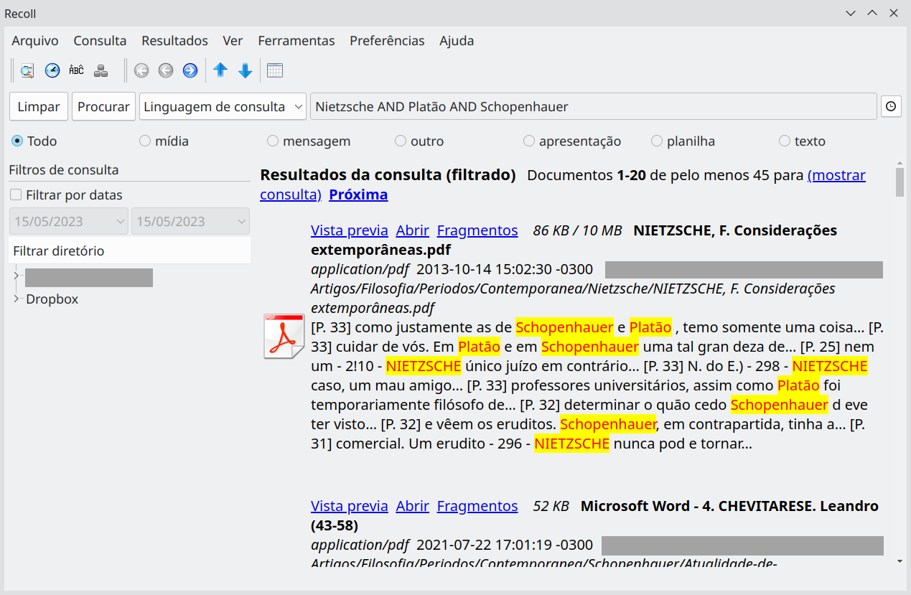

# recoll_pt-br
Tradução do Recoll para português do Brasil, aplicativo desktop para pesquisa (indexador) de textos (.txt, .pdf, .odt, .ods, .csv, .xlsm, .doc, .docx...)

O Recoll (www.recoll.org) é baseado no Xapian (www.xapian.org), para o qual fornece uma poderosa camada de extração de texto e uma interface gráfica Qt completa, mas fácil de usar.

A tradução do Recoll começou sem pretensão de torná-la pública, na maior parte do tempo usei o Google Translator. No entanto, não foi um trabalho rápido e precisei fazer algumas descobertas (tinha textos que não estavam no arquivo de tradução), logo, acredito que outras pessoas possam se interessar e, também, melhorar a tradução, principalmente em relação aos termos técnicos.

# Arquivos

| Arquivo | O que é |
|---|---|
| `recoll_pt.qm` | Tradução pronta para uso (compilada). É este que o Recoll lê. |
| `recoll_pt.ts` | Fonte da tradução (XML), para abrir e editar no Qt Linguist. |
| `guia-rapido-consulta-recoll.md` | [Guia rápido da linguagem de consulta do Recoll](guia-rapido-consulta-recoll.md), em português. |
| `manual/usermanual.html` | Manual do usuário do Recoll (ajuda do F1) traduzido, com um Apêndice C a mais: dicas do campo de pesquisa, o guia rápido e exemplos de consultas. |
| `manual/docbook-xsl.css` | Estilo do manual (o mesmo do original). |

**Situação atual:** interface com tradução completa (881 de 881 textos), testada no Recoll 1.43.0 (Debian 13). Manual do Recoll 1.42/1.43 traduzido (1643 de 1686 trechos; os que faltam são assinaturas de funções da API e nomes de seções de arquivos de configuração, que ficam em inglês).

# Instalação

1. Baixe o arquivo `recoll_pt.qm`.

2. Copie para o diretório de traduções do Recoll (faça antes uma cópia do arquivo original, se existir):

   ```
   sudo cp /usr/share/recoll/translations/recoll_pt.qm /usr/share/recoll/translations/recoll_pt.qm.old
   sudo cp recoll_pt.qm /usr/share/recoll/translations/
   ```

3. Abra o Recoll. Ele usa a tradução de acordo com o idioma do sistema (pt_BR / pt).

Sugestão: deixe o arquivo `recoll_pt.qm` dentro da pasta de configuração do Recoll em sua home (`~/.recoll`) e crie um link simbólico para ele:

```
sudo ln -sf ~/.recoll/recoll_pt.qm /usr/share/recoll/translations/recoll_pt.qm
```

Observação: atualizações do pacote do Recoll podem substituir o arquivo em `/usr/share/recoll/translations/`. Se a tradução sumir depois de uma atualização, repita o passo 2 (ou recrie o link).

## Manual (ajuda do F1)

O F1 do Recoll abre `/usr/share/recoll/doc/usermanual.html`, que no Debian aponta para `/usr/share/doc/recoll/usermanual.html`. Para usar o manual traduzido, guarde o original e copie a pasta `manual` do repositório:

```
sudo cp /usr/share/doc/recoll/usermanual.html /usr/share/doc/recoll/usermanual.html.orig
sudo cp manual/usermanual.html manual/docbook-xsl.css /usr/share/doc/recoll/
```

O caminho pode mudar conforme a distribuição; veja para onde apontam os links dentro de `/usr/share/recoll/doc`. Atualizações do pacote também gravam o manual em inglês por cima; nesse caso, copie de novo. O manual também pode ser aberto direto no navegador.

# Para traduzir

1. O aplicativo usado para traduzir é o Qt Linguist, que é muito intuitivo. Ele faz parte das ferramentas do Qt: no Arch Linux vem no pacote `qt6-tools` (ou `qt5-tools`); no Debian/Ubuntu, em `qt6-tools-dev-tools` / `linguist-qt6` (ou `qttools5-dev-tools`). Veja em qual pacote ele está na distribuição Linux que usa.

2. Abra o arquivo `recoll_pt.ts` no Qt Linguist e comece a traduzir ou corrigir.

3. No caso do Recoll, as traduções originais ficam em `/usr/share/recoll/translations/`. Os arquivos possuem o nome `recoll_XX.qm`, onde XX é o idioma do arquivo; para o português o nome precisa ser `recoll_pt.qm`.

4. Para gerar o arquivo QM, no Qt Linguist clique no menu "File" e depois "Release" ou "Release As". Também é possível pela linha de comando:

   ```
   lrelease recoll_pt.ts -qm recoll_pt.qm
   ```

5. Quando sair uma versão nova do Recoll com textos novos, os textos que faltam aparecem como não traduzidos no Qt Linguist. Os arquivos `.ts` de cada versão estão no código-fonte do Recoll (pasta `src/qtgui/i18n`).

# Dicas

## Linguagem de consulta
Veja o [guia rápido da linguagem de consulta](guia-rapido-consulta-recoll.md): operadores (E, OU, NÃO), frases, proximidade, curingas, campos (`author:`, `dir:`, `date:`, `size:`...) e exemplos prontos.

## Melhorando a resolução do Recoll

Se o Recoll ficar com botões feios na escala que usa, é possível resolver escolhendo uma escala apenas para ele. Se você utiliza o KDE Plasma, execute o Recoll da seguinte forma:

    env QT_SCALE_FACTOR=0.8 recoll

Onde 0.8 é a escala que estou usando para o Recoll, você pode escolher outra: 0.9, 1.0, 1.25...

Se estiver usando o Gnome ou alguma outra DE ou WM que usa GTK3, você deve utilizar (não testei):

    env GDK_DPI_SCALE=0.8 recoll

## Resolvendo o problema "aspell dictionary creation command failed"

Caso esteja recebendo a mensagem abaixo:

    Non-fatal indexing message:
    aspell : aspell dictionary creation command failed: /usr/bin/aspell --lang=pt --encoding=utf-8 create master /home/usuario/.recoll/aspdict.pt.rws One possible reason might be missing language data files for lang = pt. Maybe try to execute the command by hand for a better diag.

Faça o seguinte:

1. No menu, clique em "Preferências" e "Configuração do índice";

2. Na primeira aba, em "Parâmetros globais", em "Idiomas de radicalização" clique no + e escolha "portuguese".

3. Logo abaixo, no campo "Idioma do Aspell" coloque pt_BR, clique no botão "OK" e saia do Recoll.

4. Abra o arquivo recoll.conf que fica na pasta .recoll em sua home (~/.recoll).

5. Acrescente no arquivo: `aspellLanguage = pt_BR`

6. Caso não tenha instalado, instale o aspell e o aspell-pt.

7. Atualize seus índices ("Arquivo" e "Atualizar índice"). Veja se o problema foi resolvido.

8. Um arquivo de nome aspdict.pt_BR.rws será criado na pasta de configurações do Recoll (~/.recoll).


